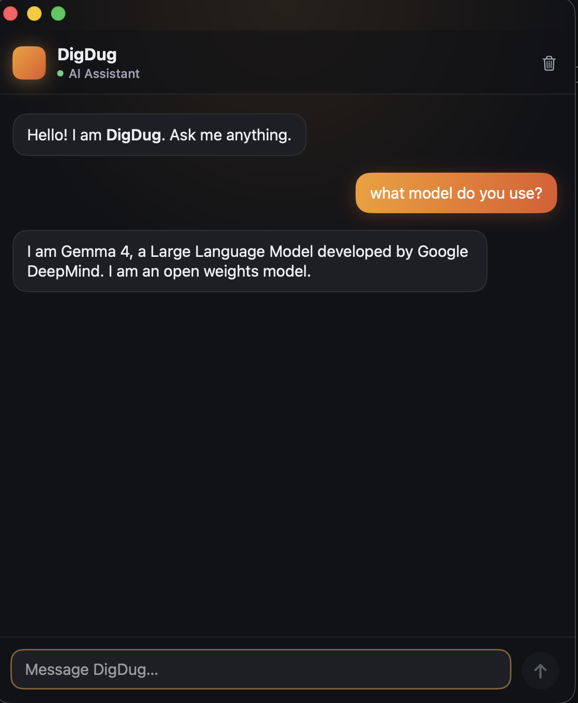
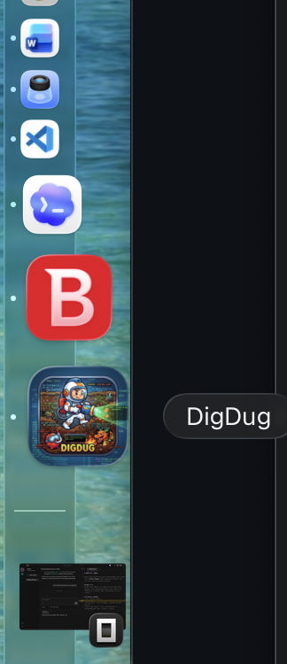

# DigDug

<p align="center">
  
</p>

A lightweight, always-on-top macOS agent that talks to **local Ollama** models. It can stream answers and organize files through confirmed, sandboxed tool calls. No cloud models are listed or used, and inference stays on your machine.

Built with Swift 6 / SwiftUI + AppKit (`NSPanel`). Markdown rendered via `swift-markdown-ui`.

## Screenshots

<p align="center">
  
</p>

<p align="center">
  
  <br>
  <em>Floating chat panel (left); lives in the Dock and menu bar (right).</em>
</p>

The screenshots above predate the October 2026 chat controls; the current app also has copy buttons and a multiline composer.

## Requirements
- macOS 13+
- Swift toolchain (Command Line Tools is enough — full Xcode not required)
- [Ollama](https://ollama.com) running locally with the model pulled:
  ```sh
  ollama pull gemma4:e4b
  ollama serve   # or the menu-bar app; listens on http://localhost:11434
  ```

DigDug discovers installed local chat models from Ollama. The default remains `gemma4:e4b`; models advertise whether tool calling and reasoning controls are available.

## Chat controls

- **Enter** sends the message; **Shift+Enter** inserts a newline, including after pasting text.
- **Copy** under a response copies plain text. Code blocks have their own copy control that preserves whitespace.
- Scroll up to read while a response streams; **Jump to latest** resumes following the response.
- Use **Stop** to cancel a response. Return never activates Stop, and a cancelled response cannot change a newer turn.
- Conversations remain in memory while the app runs. Closing the panel hides it; quitting the app clears the conversation.

## Agent features

- Select any installed local completion model from the panel.
- Set reasoning effort for models that advertise thinking support.
- List, search, read, create, copy, move, rename, trash, or delete files.
- Review live tool activity, confirm destructive actions, or stop the task.
- Block system writes and credential-directory reads after resolving symlinks.
- Organize up to 100 files through one reviewable mapping plan; uncertain and duplicate files remain untouched.
- Inspect canonical path, type, size, and dates without reading file content; verify exact duplicates with local SHA-256 hashing.
- Roll completed moves back automatically if a later move in the same batch fails.

## Run
```sh
swift run DigDug                 # launch the panel directly
# or build a double-clickable app:
bash scripts/make_app.sh         # → build/DigDug.app
bash scripts/make_app.sh --install   # also copies to /Applications
```

### Choose the installed app

The installed app is **`/Applications/DigDug.app`**. A local bundle at `build/DigDug.app` is a separate copy and is not updated by installing another build. Spotlight can list both; hold **Command** on a selected result to inspect its location.

To open the installed copy directly:

```sh
open /Applications/DigDug.app
```

After installing an update, quit any already running DigDug instances and reopen the installed copy. Closing the panel only hides it. Use the menu-bar item's right-click menu to quit; save any needed conversation text first.

### Local toolchain fallback

On this machine, the default macOS 27 SDK lacks the `SwiftUIMacros` plugin needed by the existing NetworkImage dependency. The installed macOS 26.5 SDK works with the native build system:

```sh
CLANG_MODULE_CACHE_PATH=/private/tmp/digdug-clang-cache swift run --disable-sandbox --build-system native --sdk /Library/Developer/CommandLineTools/SDKs/MacOSX26.5.sdk DigDug
```

These flags are a machine-specific workaround. `make_app.sh` currently uses the default SDK and does **not** read `DIGDUG_SDK_PATH`; that variable belongs to the chat-test script. Release packaging on this machine required applying the same SDK/build-system flags and reusing the existing app icon after sandboxed icon generation failed. See [build and packaging notes](learnings.md#release-packaging-and-installed-copy-2026-10-25).

## Test
```sh
swift run DigDugTestRunner       # ✅ runs swift-testing for real
# swift test                     # ❌ silently skips under CLT-only — do not use
```
Chat interaction regressions (native editor, clipboard, scrolling, and cancellation):
```sh
bash scripts/test_chat_ui.sh
```
This uses temporary named clipboards and a non-visible test window. It needs normal macOS pasteboard access.
For the installed CLT/macOS 27 SDK mismatch, set `DIGDUG_SDK_PATH=/Library/Developer/CommandLineTools/SDKs/MacOSX26.5.sdk` when running this script; see `learnings.md`.

Why: Command Line Tools has no `xctest` host, so `swift test` exits 0 without running. The `DigDugTestRunner` executable calls the swift-testing entry point directly. See `learnings.md`.

For the same local SDK issue, run both test suites with:

```sh
CLANG_MODULE_CACHE_PATH=/private/tmp/digdug-clang-cache swift run --disable-sandbox --build-system native --sdk /Library/Developer/CommandLineTools/SDKs/MacOSX26.5.sdk DigDugTestRunner
DIGDUG_SDK_PATH=/Library/Developer/CommandLineTools/SDKs/MacOSX26.5.sdk bash scripts/test_chat_ui.sh
```

The latest verified result is **35 Core tests plus 8 chat interaction tests**. See [validation details and pending manual checks](docs/validation.md).

## Layout
| Path | Purpose |
|---|---|
| `Sources/DigDugCore/` | Ollama chat client, agent loop, typed tools, and safety policy |
| `Sources/DigDugApp/` | App lifecycle, floating panel, SwiftUI views, `Theme.swift` tokens |
| `scripts/` | App packaging, icon generation, and `test_chat_ui.sh` |
| `Tests/` | Core swift-testing suites + standalone `Runner.swift` |
| `UITests/` | Native composer, copy, cancellation, and scroll regression tests |
| `docs/` | spec, decisions, validation, reference index |

## AI operating surface
This repo is set up for agentic development (per *Elite AI-Assisted Coding*):

| Surface | File / location |
|---|---|
| Rules (always-on) | [`AGENTS.md`](./AGENTS.md) — canonical; [`CLAUDE.md`](./CLAUDE.md) defers to it |
| Spec (the contract) | [`docs/spec.md`](./docs/spec.md) |
| Design intent | [`PRODUCT.md`](./PRODUCT.md) |
| Decisions (ADR) | [`docs/decisions.md`](./docs/decisions.md) |
| Validation | [`docs/validation.md`](./docs/validation.md) |
| Reference index | [`docs/reference-index.md`](./docs/reference-index.md) |
| Live work state | `plan.md`, `progress.md`, `TASKS.md` |
| Learnings / traps | [`learnings.md`](./learnings.md) |
| Skills | `.agents/skills/` (`setup-and-run`, `digdug-domain-reference`, `impeccable`) |
| MCP | `opencode.json` → `fetch` server (runtime HTTP / doc access) |

Tool used: [opencode](https://opencode.ai) with a local Ollama coding model, and Claude Code.

## Acknowledgments
The agentic operating surface in this repo (rules, spec, skills, MCP, living docs) was inspired by **Eleanor Berger**'s *Elite AI-Assisted Coding* course. The structure here is my own application of those ideas; the course material itself is not included.
